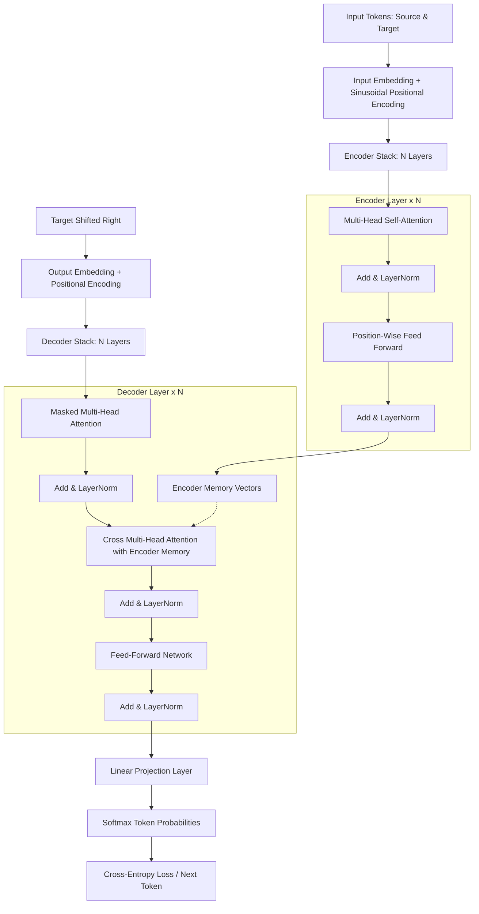
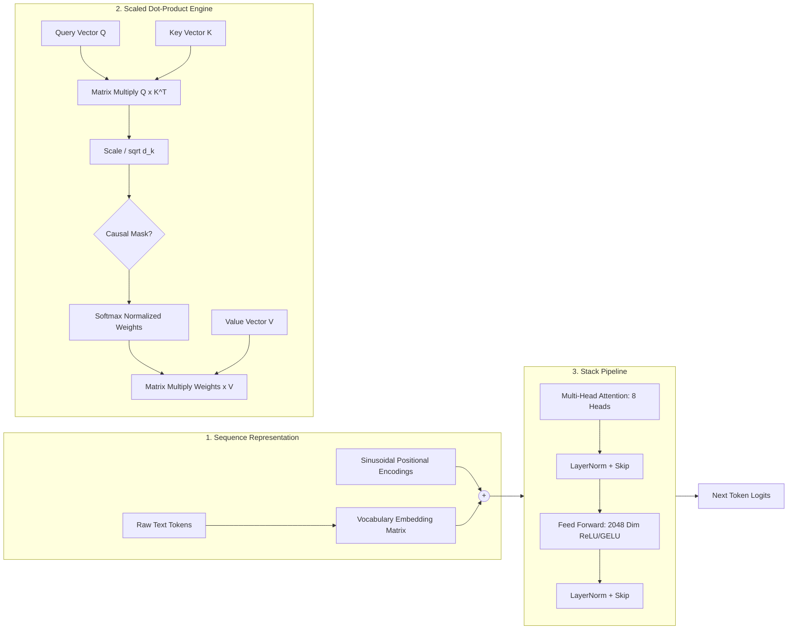
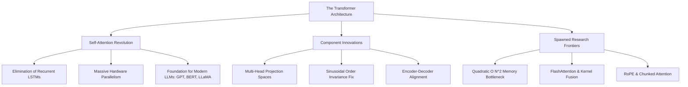

# Research Dossier: Attention Is All You Need

**Authors:** Vaswani et al. (Google Brain & Google Research)
**Year:** 2017
**Domain:** Natural Language Processing & Sequence Modeling
**Source:** https://arxiv.org/abs/1706.03762

---

## 📌 Executive Summary (TL;DR)

Introduces the Transformer architecture, which dispenses with recurrence and convolutions entirely, relying solely on multi-head self-attention to achieve state-of-the-art translation with superior parallelization.

### Problem Statement
Recurrent models (RNNs, LSTMs, GRUs) compute representations sequentially along token positions, creating an inherent computational bottleneck that inhibits parallelization across long context lengths and suffers from vanishing gradients over distant tokens.

### Proposed Solution
The Transformer replaces recurrent hidden state propagation with Scaled Dot-Product Multi-Head Self-Attention combined with Sinusoidal Positional Encoding, enabling constant-time paths between arbitrary token pairs and massive batch parallelization.

### Key Breakthrough
Multi-Head Self-Attention allowing token-to-token associative interaction in O(1) sequential steps without recurrence.

## 🧩 Core Concepts Breakdown

### 1. Scaled Dot-Product Attention (Attention Mechanism)
**Definition:** A mechanism that calculates attention weights by computing the inner product of queries and keys, scaling by the square root of dimension d_k, and applying softmax before multiplying by values.

> **Intuition:** Think of looking up a book in a library: Query is what you seek, Keys are book spine tags, and Values are the page contents. Scaling prevents large dot products from pushing softmax into saturation with vanishing gradients.

```text
Attention(Q, K, V) = softmax((Q * K^T) / sqrt(d_k)) * V
```

* **Impact:** Eliminates iterative sequential unrolling; allows parallel matrix multiplications across all sequence tokens.
* **Trade-offs:** O(N^2) memory and compute complexity with sequence length N, making naive Transformers costly for very long contexts.

### 2. Multi-Head Attention (MHA) (Architecture)
**Definition:** Projecting queries, keys, and values h times with learned linear projections to d_k, d_k, and d_v dimensions, running attention in parallel, and concatenating outputs.

> **Intuition:** Rather than averaging all relations into a single perspective, multiple heads allow the model to simultaneously attend to syntax, semantic references, coreference, and grammatical agreements.

```text
MultiHead(Q, K, V) = Concat(head_1, ..., head_h) * W^O, where head_i = Attention(Q*W_i^Q, K*W_i^K, V*W_i^V)
```

* **Impact:** Substantially expands representational capacity without increasing total computational cost (since each head operates in a reduced subspace).
* **Trade-offs:** Higher memory bandwidth requirement due to multiple projection tensors and cache fragmentation during autoregressive decoding.

### 3. Positional Encoding (Sinusoidal) (Input Representation)
**Definition:** Deterministic sine and cosine functions of varying frequencies added to the input token embeddings to inject token ordering information into the permutation-invariant attention matrix.

> **Intuition:** Since self-attention treats a sentence as an unordered set of tokens, positional waves give each index a unique mathematical fingerprint with easily learnable relative linear shifts.

```text
PE(pos, 2i) = sin(pos / 10000^(2i/d_model)), PE(pos, 2i+1) = cos(pos / 10000^(2i/d_model))
```

* **Impact:** Allows the model to extrapolate to sequence lengths longer than those encountered during training.
* **Trade-offs:** Fixed absolute sinusoidal encodings do not natively encode relative distance as effectively as modern learned or Rotary Position Embeddings (RoPE).

### 4. Residual Connections & LayerNorm (Pre/Post-LN) (Optimization)
**Definition:** Skipping each sub-layer with an identity connection LayerNorm(x + Sublayer(x)), preserving gradient highways through deep encoder-decoder stacks.

> **Intuition:** Prevents signal degradation and enables uninterrupted gradient backpropagation through 12 to 100+ stacked layers.

```text
Output = LayerNorm(x + SubLayer(x))
```

* **Impact:** Enabled training of very deep neural networks without exploding or vanishing gradients.
* **Trade-offs:** Original Post-LN requires a careful learning rate warmup phase; modern models often prefer Pre-LN or RMSNorm for stability.

## 🔄 Architecture & Methodology Flowcharts

### 1. Methodology Execution Pipeline


### 2. Architecture Modules


### 3. Concept Mindmap


## ⚖️ Comparative Taxonomy

### Prior Work Limitations
- LSTMs & GRUs: Strictly sequential token-by-token state updates requiring O(N) sequential computation steps.
- ByteNet & WaveNet: Convolutional hierarchies that required O(log N) or O(N) layers to connect distant words.
- Standard Recurrent Attention: Required calculating attention on top of recurrent state representations, preventing full parallelization.

### Novel Contributions
- Complete replacement of recurrence and convolution with multi-head self-attention.
- Constant O(1) path length connecting any two arbitrary tokens in sequence.
- Sinusoidal positional encoding function injecting relative sequence order.
- Trained translation models in 3.5 days on 8 GPUs compared to weeks for ensemble RNNs.

### Scope & Limitations
- Quadratic O(N^2) time and memory complexity with sequence length N.
- Inability to naturally stream infinite-length continuous sequences without chunking.
- Extrapolating beyond training position boundaries with fixed sinusoidal encoding proved noisy.

## 🎓 Curated Student Project Ideas

### Project 1: Build a Minimal Transformer from Scratch in Pure PyTorch [Beginner Level - 1-2 weeks]
*Demystifying Attention without High-Level HuggingFace Wrappers*

Implement every tensor operation of Scaled Dot-Product Attention, Multi-Head Attention, and Positional Encodings in ~200 lines of PyTorch. Train it on a toy character-level Shakespeare or arithmetic dataset to watch attention matrices emerge.

* **Why It Matters:** Deeply solidifies fundamental tensor broadcasting, matrix manipulations, and causal masking mechanics, which are the #1 screening topic in ML engineering interviews.
* **Prerequisites:** Python basics, PyTorch tensor slicing & matrix multiplication, Basic understanding of cross-entropy loss
* **Tech Stack:** Python, PyTorch, Matplotlib (for attention heatmap visualization), Jupyter Notebook
* **Datasets:** Tiny Shakespeare (1MB text), Synthesized Reversed Character Strings, Character-level addition (e.g. 12 + 34 = 46)
* **Novel Angle:** Visualize whether individual attention heads specialize into specific grammatical roles (e.g., noun-verb tracking vs punctuation tracking).

#### Implementation Milestones:
1. **Phase 1: Attention Tensor Math** - Implement ScaledDotProductAttention module with query, key, value projections and scaling.
1. **Phase 2: Multi-Head Reshaping** - Reshape tensors for h parallel heads using .view() and .transpose() without for-loops.
1. **Phase 3: Encoder & Decoder Stacking** - Assemble residual blocks with nn.LayerNorm and test causal triangular masking.
1. **Phase 4: Training & Heatmap Plots** - Train for 15 epochs on Shakespeare and plot head-by-head attention heatmaps.

### Project 2: Interactive Web-Based Attention Head Inspector [Intermediate Level - 3-4 weeks]
*Streamlit/React visualizer for inspecting token-to-token weights in real time*

Develop an interactive web application that loads a pretrained lightweight Transformer (like DistilBERT or GPT-2 small) and lets users type custom prompts to visualize interactive bipartite graph attention lines and layer-by-layer saliency maps.

* **Why It Matters:** Interpretability and mechanistic interpretability are booming research fields. Building visual diagnostic tools creates a standout portfolio asset.
* **Prerequisites:** Hugging Face Transformers library, React or Streamlit, FastAPI backend
* **Tech Stack:** FastAPI, React / Tailwind, BertViz, PyTorch, Hugging Face Transformers
* **Datasets:** User-entered text prompts, Stanford Sentiment Treebank (SST-2), Multi-lingual sentence pairs
* **Novel Angle:** Compare attention sparsity between truthful statements and hallucinations or trick questions.

#### Implementation Milestones:
1. **Phase 1: Model Hooking** - Register PyTorch forward hooks to extract attention weight tensors at inference time.
1. **Phase 2: Backend API** - Build a REST endpoint returning tokens and 12x12 attention weight matrices.
1. **Phase 3: Interactive UI** - Render interactive SVG chord/bipartite line diagrams where hovering on a token highlights attended tokens.
1. **Phase 4: Evaluation Metrics** - Add head entropy calculations to identify which heads are diffuse vs highly focused.

### Project 3: Linearized Attention vs Vanilla Quadratic Attention Benchmark [Advanced Level - 6-8 weeks]
*Empirical comparison of compute, peak VRAM, and accuracy under scaling context*

Benchmark the standard O(N^2) Softmax Attention against Linear Attention approximations (like Performer/Random Feature Kernel or FlashAttention-style tiling) across sequence lengths from 512 to 8,192 tokens on consumer GPUs.

* **Why It Matters:** Long-context scaling is the central engineering challenge of 2024-2026 AI infrastructure. Understanding memory-bound vs compute-bound kernels is vital.
* **Prerequisites:** PyTorch CUDA profiling / torch.cuda.memory_allocated, Kernel intuition, Benchmarking rigor
* **Tech Stack:** PyTorch, TorchScript / Triton basics, Weights & Biases (WandB), Matplotlib / Seaborn
* **Datasets:** WikiText-103, Long Range Arena (LRA) Benchmark tasks, Synthetic associative recall
* **Novel Angle:** Evaluate how degradation in associative recall tasks correlates with attention rank approximation.

#### Implementation Milestones:
1. **Phase 1: Baseline Instrumentation** - Set up automated timing and CUDA peak memory recording harnesses.
1. **Phase 2: Alternative Kernel Integration** - Integrate kernelized linear attention and compare against scaled dot-product.
1. **Phase 3: Stress Testing** - Sweep sequence lengths [512, 1024, 2048, 4096, 8192] to measure out-of-memory thresholds.
1. **Phase 4: Paper Writeup** - Author a clean technical report summarizing Pareto frontiers of speed vs task perplexity.

## ❓ Open Research Questions

- How can we scale self-attention to million-token contexts without O(N^2) quadratic memory explosion?
- Can non-causal bidirectional attention representations (BERT) be cleanly fused with causal autoregressive generation (GPT)?
- How do attention patterns evolve during in-context learning vs weight-update fine-tuning?

---
*Generated by ScholarFlow - Research Paper AI Agent*
